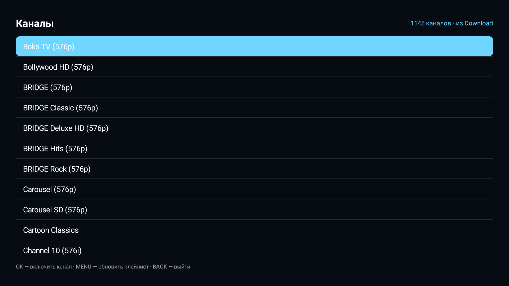

<div align="center">

# SlimIPTV

**IPTV-плеер для Android TV: список каналов, цифровой ввод с пульта, автообновление плейлиста.**

[](LICENSE)
[](https://github.com/mosloboev444-hue/slimiptv/releases/latest)
[](https://developer.android.com/tv)
[](#)

[Скачать APK](https://github.com/mosloboev444-hue/slimiptv/releases/latest) · [Другие проекты](#экосистема)

</div>



## Что умеет

- **Плейлист M3U**: 1252 встроенных российских канала (проверены двумя прогонами) или свой файл `/sdcard/Download/ru.m3u`.
- **Автообновление**: тянет свежий плейлист с GitHub при запуске и раз в сутки, кэширует локально; MENU — обновить сразу.
- **Пропуск мёртвых каналов**: ошибка или 12 секунд без потока — плеер сам уходит на следующий, битые запоминает.
- **Цифровой ввод**: набрал номер пультами — включился канал; `DEL` — сброс.
- **Логотипы каналов** в списке (асинхронная загрузка с кэшем).
- **Звук не мешает**: при открытии списка и при выходе на рабочий стол воспроизведение останавливается.
- **Автозапуск**: играет последний канал (или первый) при старте.

## Пульт

| кнопка | действие |
|---|---|
| OK | включить канал из списка |
| ▲ ▼ | соседний канал |
| 0–9 | номер канала, `DEL` — сброс |
| MENU | показать/скрыть список |
| ↩ | назад / выход |

## Установка

```bash
adb install -r SlimIPTV-1.8.apk
adb push my.m3u /sdcard/Download/ru.m3u   # необязательно
```

## Проверка плейлиста

Публичные плейлисты быстро устаревают. В репозитории есть скрипты:

```bash
# одиночная проверка своего файла
python tools/verify_playlist.py ru.m3u -o ru_working.m3u --workers 20 --dedupe

# двухпроходная проверка (канал остаётся, если ответил дважды)
python tools/two_pass_verify.py
```

Требуется `ffprobe` (из состава ffmpeg). Реальный прогон: 1531 поток → 1252 канала, ответивших дважды.

## Экосистема

| проект | что это |
|---|---|
| [SlimHome](https://github.com/mosloboev444-hue/slimhome) | лаунчер для ТВ: стеклянная сетка, погода, кнопка VPN |
| **SlimIPTV** | этот плеер |
| [SlimVPN](https://github.com/mosloboev444-hue/slimvpn) | VPN-клиент AmneziaWG с автоподключением под YouTube |

## Лицензия

MIT — см. [LICENSE](LICENSE). Код и дизайн: **Andrey Masloboev**.
Плейлисты — публичные наборы из [ngrch/iptv](https://github.com/ngrch/iptv) и [iptv-org/iptv](https://github.com/iptv-org/iptv); права на вещание принадлежат их владельцам.