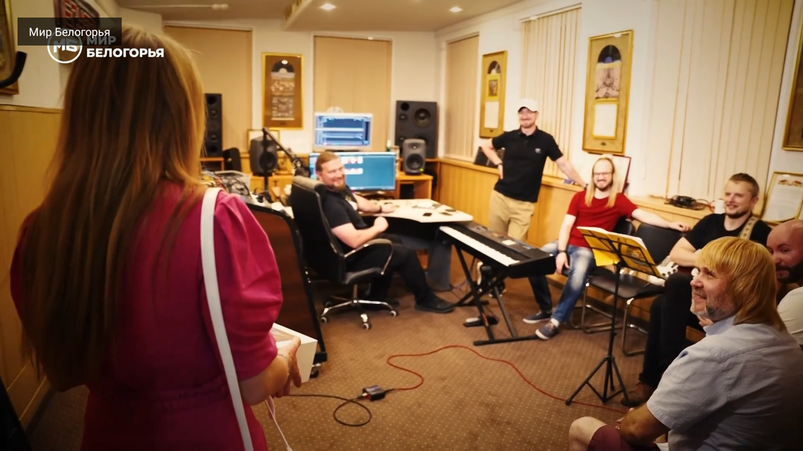

# SlimIPTV — простой IPTV-плеер для Android TV

[](LICENSE)
[](https://github.com/mosloboev444-hue/slimiptv/releases/latest)
[](https://developer.android.com/tv)

Лёгкий плеер для просмотра IPTV на ТВ-приставке: список каналов, переключение стрелками пульта,
HLS и HTTP-потоки, свой плейлист с диска. Написан на Java без сторонних библиотек — **48 КБ APK**,
без рекламы, аккаунтов и аналитики.


## Возможности

- **Плейлист M3U** — встроенный набор из 1252 российских каналов, проверенных двумя прогонами подряд или ваш файл
  `/sdcard/Download/ru.m3u` (он приоритетнее встроенного).
- **Список каналов** — название и категория, крупный шрифт, подсветка фокуса.
- **Воспроизведение** — системный `MediaPlayer` (HLS/HTTP), подготовка потока в фоновом потоке,
  поэтому интерфейс не подвисает даже на мёртвых каналах.
- **Статусы** — «Подключение…», «Буферизация…», «Канал недоступен», «Поток завершён».
- **Автообновление плейлиста** — при запуске и раз в сутки приложение скачивает свежий список с GitHub, кэширует локально; MENU — принудительное обновление.
- **Автозапуск** — открывается автоматически при включении приставки.

## Управление пультом

| кнопка | действие |
|---|---|
OK | включить канал из списка |
↑ / ↓ (в плеере) | следующий / предыдущий канал |
BACK | вернуться к списку |
MENU | перечитать плейлист из `Download/ru.m3u` |



## Установка

```bash
adb install -r release/SlimIPTV-1.3.apk
adb push ru.m3u /sdcard/Download/ru.m3u   # необязательно: свой плейлист
```

Требования: Android TV 8.0+ (API 26), ARM.

## Проверка плейлиста

Публичные плейлисты быстро «гниют»: часть каналов перестаёт отвечать. В репозитории есть скрипт,
который оставляет только живые потоки (нужен `ffprobe` из состава ffmpeg):

```bash
# двухпроходная проверка: канал остаётся, только если ответил дважды
python tools/two_pass_verify.py
# или быстрая одиночная проверка своего файла
python tools/verify_playlist.py ru.m3u -o ru_working.m3u --workers 20 --dedupe
```

Скрипт проверяет каждый поток, удаляет нерабочие, при `--dedupe` убирает дубли по названию
и сортирует по категории. Пример реального прогона: 1531 поток → 1252 канала, ответивших дважды подряд.

## Сборка

```bash
# JDK 17 + Android SDK platform 34, build-tools 34.0.0
./gradlew assembleRelease
```

Для подписи положите рядом `keystore.properties`:

```properties
storeFile=/путь/к/ключу.jks
storePassword=пароль
keyAlias=алиас
keyPassword=пароль
```

Без этого файла release соберётся с debug-подписью (годится для сайдлоада).

## Лицензия

MIT — см. [LICENSE](LICENSE). Код и дизайн: **Andrey Masloboev**.
Плейлисты — публичные наборы из проектов [ngrch/iptv](https://github.com/ngrch/iptv)
и [iptv-org/iptv](https://github.com/iptv-org/iptv); права на вещание принадлежат их владельцам.